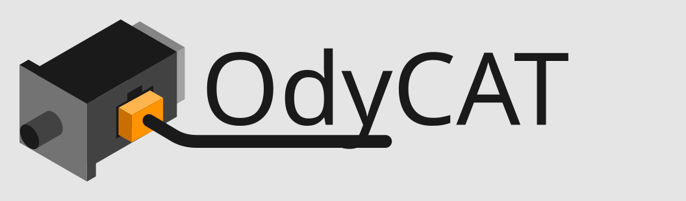

<p align="center">
  <picture>
    <source media="(prefers-color-scheme: dark)" srcset="docs/img/odycat_letters_dark.svg">
    
  </picture>
</p>

<p align="center"><b>Automatización industrial de código abierto en Python</b></p>

<p align="center">
  <a href="https://pypi.org/project/odycat/"></a>
  <a href="https://pypi.org/project/odycat/"></a>
  <a href="https://github.com/odycat/odycat/blob/main/LICENSING.md"></a>
  <a href="https://github.com/odycat/odycat/actions/workflows/ci.yml"></a>
  <a href="https://docs.odycat.org/es/stable/"></a>
  
</p>

<p align="center"><a href="README.md">English</a> · Español</p>

## ¿Qué es OdyCAT?

OdyCAT permite controlar desde scripts de Python módulos EtherCAT como bancos de entradas/salidas (digitales, analógicas, contadores, PWM...), variadores de frecuencia, servomotores y, prácticamente, cualquier dispositivo EtherCAT, desde un sistema base Linux.

El objetivo es proveer a automatistas, integradores, líneas de producción, equipos de investigación, aficionados a la robótica, personal de mantenimiento, etc., de una herramienta robusta que les permita concentrarse en el desarrollo de su aplicación sin tener que pelear con las comunicaciones de bus.

OdyCAT abre la puerta a combinar en la misma máquina el control de la automatización, servomotores, algoritmos de guiado y navegación y visión artificial, en el lenguaje de programación más usado en el mundo. Junto con otras librerías como OpenCV, NumPy, SciPy, Matplotlib, PyQtGraph, FastAPI, SQLite, Snap7... compone un stack sólido sobre el que desarrollar robótica para prácticamente cualquier aplicación.

¿Cómo funciona? Esto es un ejemplo mínimo para encender una salida y mantenerla durante un segundo:

```python
import time
from odycat.devices.beckhoff import EL2004

out = EL2004(label="outputs")   # the EL2004 labelled outputs in the config
out.set_output_1(True)          # output 1 on
time.sleep(1)
out.set_output_1(False)         # output 1 off
```

## Inicio rápido

- Hardware mínimo: PC con x86-64 o aarch64 (ARM/Pi), puerto de red RJ45. Con una velocidad de 10/100 Mb/s es suficiente, pesa más que el puerto sea PCI, aunque el sistema funciona incluso sobre adaptadores USB-Ethernet (degradando ligeramente el rendimiento real-time, normalmente poco relevante para E/S, VFD y servomotores en modo PP/PV/PT o freerun)

- En una instalación limpia de Debian 13, Ubuntu 24.04 o 26.04 LTS, Raspberry Pi OS o Armbian (x86-64 o
aarch64), con los esclavos EtherCAT conectados al puerto RJ45:

```sh
# Instala git por si no se encuentra ya instalado
sudo apt install git
# Clona el repositorio
git clone https://github.com/odycat/odycat
# Lanza el instalador, durante el proceso pregunta qué tarjeta de red asignar al bus EtherCAT
# Previamente puedes ver las tarjetas disponibles con el comando: 
# ip a
sudo odycat/install/install.sh          
```
- Reinicia el sistema/reinicia la sesión para recargar los permisos de usuario, después:

```sh
# Creamos una carpeta donde ubicar los archivos de prueba
mkdir odycat_test && cd odycat_test
# Creamos un entorno virtual para no contaminar las librerías del sistema
# Si python3-venv no está instalado, instálalo con:
# sudo apt install python3-venv
python3 -m venv .venv
# Activamos el entorno virtual
source .venv/bin/activate
# Instalamos OdyCAT desde su repositorio en PyPI
pip install odycat
# Ejecutamos la utilidad de la librería que escanea el bus para listar los dispositivos EtherCAT. El parámetro -o escribe la configuración de los dispositivos conectados como JSON con el nombre dado:
odycat-config scan -o busconfig.json 
# Podemos ahora lanzar el "engine" de OdyCAT pasando como argumento la configuración generada.
# Este programa se queda funcionando 
sudo odycat busconfig.json 

# en otro terminal, en odycat_test:
.venv/bin/python -c "from odycat import Bus; b = Bus(); print('OP' if b.is_op else 'not OP', b.work_counter, '/', b.expected_wkc)"
```

Cada paso se explica en [primeros pasos](docs/getting-started.md).

## Detalles de OdyCAT

- **Un PC, un lenguaje, control total:** E/S, accionamientos, visión, bases
  de datos y tu HMI en Python, en el mismo ordenador.
- **Un script de Python por tarea:** un engine de tiempo real en C hace
  funcionar el ciclo e intercambia los datos con tus scripts a través de
  memoria compartida. Ejecuta tantos scripts como necesites y divide una
  máquina, o una línea entera, en programas pequeños e independientes,
  fáciles de leer y mantener.
- **Sin IDE del fabricante, sin keys de runtime, sin límites de tiempo, nada entre tú y la
  máquina:** cualquier editor y las herramientas habituales de Python.
  
- **Sin límites artificiales** de dispositivos, ejes o E/S. Tiempos de ciclo
  del bus configurables de 125 µs a 10 ms. La potencia del hardware empleado es el único limitante.
- **Señales y registros de eventos:** señales relacionadas con eventos de flancos, cambios de valor y esclavos que salen de
  OP.
- **Pilas incluidas:** con clases de dispositivo listas para usar, con diferentes niveles de soporte por parte del proyecto, fabricantes y comunidad.
  ([catálogo de dispositivos](docs/devices.md)).
- **Soporte de seguridad:** cada release tiene un periodo de soporte
  publicado y una política de vulnerabilidades ([SECURITY.md](SECURITY.md));
  con una licencia comercial, la información de seguridad propia de OdyCAT
  para el expediente técnico de tu máquina (Reglamento de Ciberresiliencia de
  la UE).
- **Despliega donde quieras:** x86-64 y ARM, desde PCs industriales fanless hasta sistemas SBC (Raspberry Pi, Orange Pi, Odroid, etc.). Ejecuta tus scripts directamente en el
  sistema o en [contenedores](docs/containers.md).
- **OdyCAT es un framework de código abierto, desarrollado en la UE, como parte del ecosistema de software libre:** Explora, modifica, combina con otros proyectos, guarda el código que ejecutan tus máquinas. Aumenta la resiliencia de tu stack de robótica y automatización. 


## ¿Dónde encaja OdyCAT?

- **Software PLC/Aplicaciones de control de máquinas:** trabaja con módulos de E/S y accionamientos
  desde Python en Linux, junto a visión artificial, SCADA o software de
  procesado de datos.
- **Integración y puesta en marcha:** configura dispositivos, inspecciona
  los datos del bus y usa los eventos y el historial de ciclos recientes para
  investigar el comportamiento de la máquina.
- **Bancos de pruebas y prototipos:** trabaja a un nivel más alto que el
  firmware, con dispositivos industriales desde el principio.

Para más detalle, ver [uso previsto](docs/intended-use.md) y
[entornos soportados](docs/compatibility.md).

## ¿Cómo funciona?

OdyCAT comanda el [IgH EtherCAT Master](https://gitlab.com/etherlab.org/ethercat)
a través de un engine de tiempo real programado en C, que replica los datos de
proceso de cada esclavo en memoria compartida. Los scripts leen entradas y
escriben salidas en esta memoria con el paquete de Python `odycat`, sin interferirse entre sí ni bloquear el proceso principal. 

El ciclo de comunicación está a cargo del engine y sus capacidades dependen del hardware empleado y la carga del sistema. En general, las configuraciones por defecto tienen rendimiento suficiente para la mayoría de aplicaciones. 

Si se requiere de una precisión mejorada y de mayor frecuencia de bus, existen opciones avanzadas detalladas en: [tiempo de ciclo y jitter](docs/realtime.md) y
[uso previsto](docs/intended-use.md). 

```
 Python scripts  ⇄  shared memory  ⇄  odycat (C, real time)  ⇄  IgH master  ⇄  slaves
```

El sistema permite además realizar acciones en base a eventos del bus, así como esperas temporales o por conteo de ciclos de comunicación, como por ejemplo:

```python
from odycat import Events
from odycat.devices.beckhoff import EL1014, EL2004

inp = EL1014(label="inputs")
out = EL2004(label="outputs")
ev = Events()

@ev.rising(inp.input_1)             # called when input 1 switches on
def pressed(e):
    out.set_output_1(not out.output_1())

while True:
    ev.sleep(0.1)                   # handlers run here, in this thread
```

- **Clases de dispositivo** para accionamientos (CiA 402) y E/S y
  clases genéricas para perfiles estándar (CiA 402, CiA 401, E/S modular
  ETG.5001).
- **Eventos** en flancos de subida y bajada, cambios de valor, esclavos que
  salen de OP.
- **Trace**: el engine guarda un registro circular de los ciclos recientes, que representa toda la información que el bus ha transmitido y recibido.

- **`odycat-config scan`** escribe la configuración del bus a partir de los datos en memoria de los propios
  esclavos conectados. Permite interaccionar con gran cantidad de dispositivos sin necesidad de archivos de configuración adicionales.

## Documentación

Empieza por [primeros pasos](docs/getting-started.md) (instalar IgH y
OdyCAT, una primera configuración, arrancar el engine). Todo lo demás está en
el [índice de la documentación](docs/README.md).

## Contacto

¿Estás evaluando OdyCAT para una aplicación y tienes dudas? [contacta con nosotros](https://www.yoctovision.com).


Para errores, mejoras y contribuciones a la librería, ver
[CONTRIBUTING.md](CONTRIBUTING.md). 

Si has encontrado un problema de seguridad, te rogamos que lo comuniques tan pronto como sea posible y en privado, siguiendo el [SECURITY.md](SECURITY.md).


## Licencia

OdyCAT está disponible bajo la GNU GPL v3 o una licencia comercial, ver
[LICENSING.md](LICENSING.md). 

Las contribuciones son bienvenidas, puedes ver en detalle cómo se gestionan en
[CONTRIBUTING.md](CONTRIBUTING.md). 

Para la toma de decisiones y dirección del proyecto, consulta: [GOVERNANCE.md](GOVERNANCE.md).


## Motivación

Soy Javier Martínez, el autor de OdyCAT y director técnico de Yoctovision, la empresa que le da soporte. He trabajado durante más de 10 años en sistemas de control, tiempo real, automatización y visión artificial, tanto electrónica como aplicaciones industriales. El código abierto me ha dado la capacidad de aprender todo ello, además de la gran mayoría de las herramientas con las que he construido mis proyectos. OdyCAT es mi forma de contribuir de vuelta: es la herramienta que me habría gustado tener, la que uso para mis proyectos y que ahora se publica como código abierto para toda persona que le sea de interés.

Las licencias comerciales y los servicios ayudan a sostener y expandir el proyecto.

<p align="center">Desarrollado en España, UE 🇪🇺</p>

<sub>OdyCAT® es copyright © Ocean Octane S.L.U. y lo publica y mantiene
Yoctovision S.L.U. bajo licencia. El nombre y el logotipo OdyCAT® son marcas
registradas de Ocean Octane S.L.U. EtherCAT® es una marca registrada y una
tecnología patentada, bajo licencia de Beckhoff Automation GmbH, Alemania.
Los demás nombres de empresas y productos son marcas de sus respectivos
propietarios y solo identifican el hardware con el que funciona OdyCAT.</sub>
