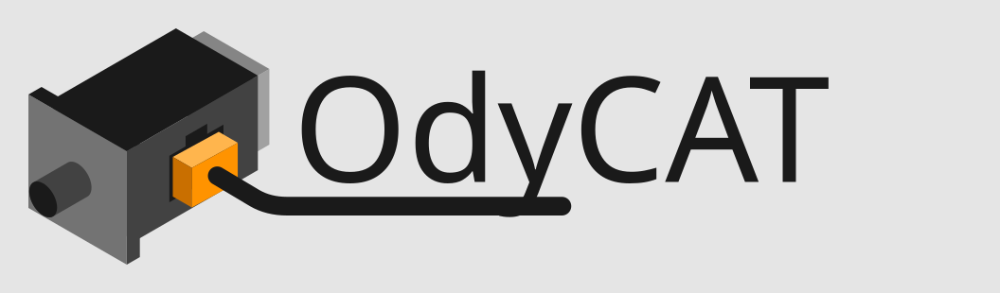

<p align="center">
  <picture>
    <source media="(prefers-color-scheme: dark)" srcset="docs/img/odycat_letters_dark.svg">
    
  </picture>
</p>

<p align="center"><b>Open machine and factory automation with Python</b></p>

## What is OdyCAT

OdyCAT connects Python programs to EtherCAT I/O and drives on Linux. It is a
tool for machine builders, integrators and engineers who want to combine
industrial control with vision, monitoring and data processing on a single
computer, in one of the world's most widely used programming languages.

What it looks like: switch an output on for one second.

```python
import time
from odycat.devices.amsamotion import EC3A_IO1632

io = EC3A_IO1632(label="io_module")  # the I/O module labelled io_module in the config
io.set_out00(True)                   # output 00 on
time.sleep(1)
io.set_out00(False)                  # output 00 off
```

## Why OdyCAT

- **One PC, one language, full control:** I/O, drives, vision, databases and
  your HMI in Python, on the same computer.
- **One Python script per task:** a real-time C
  engine runs the cycle and exchanges data with your scripts through shared
  memory. Run as many scripts as you need and split a machine, or a whole
  line, into small independent programs, easy to read and maintain.
- **No vendor IDE, no runtime keys, nothing between you and the machine:**
  any editor and the usual Python tools, AI assistants included. It's
  Python, after all.
- **No artificial limits** on device count, axes or I/O. Configurable bus cycle times from 125 µs
  to 10 ms.
- **See what happened:** a cycle-by-cycle trace of recent activity, 
  and events on edges, value changes and slaves leaving OP.
- **Batteries included:** device classes in the `tested` tier are tested on
  the real device before each release ([device catalogue](docs/devices.md)).
- **Security support:** every release has a published
  support period and a vulnerability policy ([SECURITY.md](SECURITY.md));
  with a commercial licence, the OdyCAT-specific security information for
  your machine's technical file (EU Cyber Resilience Act).
- **Deploy where you want:** x86-64 and ARM, from fanless industrial PCs 
  to single-board computers. Run your scripts on the host or in 
  [containers](docs/containers.md).
- **Open source, developed in the EU:** inspect, keep and repair the code
  your machines run. Become resilient.

## Where OdyCAT fits

- **Machine control applications:** work with I/O and drives from Python on
  Linux, alongside machine vision, SCADA or data-processing software.
- **Integration and commissioning:** configure devices, inspect bus data and
  use events and recent cycle history to investigate machine behaviour.
- **Test benches and prototypes:** work at a higher level than firmware, 
  using industrial devices from the outset.

For more detail, see [intended use](docs/intended-use.md) and [supported environments](docs/compatibility.md).

## How it works

OdyCAT drives the [IgH EtherCAT Master](https://gitlab.com/etherlab.org/ethercat)
through a small real-time C engine, which mirrors the process data of every
slave into shared memory. Scripts read inputs and write outputs there with
the `odycat` package, without making the engine wait for Python (scripts
that write the same outputs coordinate with a lock held for microseconds).
How steady the cycle is depends on the computer: see
[cycle time and jitter](docs/realtime.md) and [intended use](docs/intended-use.md).

```
 Python scripts  ⇄  shared memory  ⇄  odycat (C, real time)  ⇄  IgH master  ⇄  slaves
```

```python
from odycat import Events
from odycat.devices.amsamotion import EC3A_IO1632

io = EC3A_IO1632(label="io_module")
ev = Events()

@ev.rising(io.in03)                 # called when IN03 switches on
def pressed(e):
    io.set_out00(not io.out00())

while True:
    ev.sleep(0.1)                   # handlers run here, in this thread
```

- **Device classes** for drives (CiA 402) and I/O, by vendor, with every
  variable as a method your editor completes; generic classes for standard
  profiles (CiA 402, CiA 401, ETG.5001 modular I/O).
- **Events** on rising and falling edges, value changes, slaves leaving OP.
- **Trace**: the engine keeps a rolling record of recent cycles (10 s by
  default). Read it before the ring overwrites older data; it is not a
  persistent audit log.
- **`odycat-config scan`** writes the bus configuration from the connected
  slaves.

## Documentation

Start with [getting started](docs/getting-started.md) (installing IgH and
OdyCAT, a first config, starting the engine). Everything else is listed in
the [documentation index](docs/README.md).

## Get in touch

Working on a machine or evaluating OdyCAT for an application? We'd be glad to
hear about it; [contact Yoctovision](https://www.yoctovision.com). For bugs,
improvements and contributions to the library, see
[CONTRIBUTING.md](CONTRIBUTING.md). Report security problems privately through
[SECURITY.md](SECURITY.md).

## Licence

OdyCAT is available under the GNU GPL v3 or a commercial licence, see
[LICENSING.md](LICENSING.md). Contributions are welcome under
[CONTRIBUTING.md](CONTRIBUTING.md); decisions are described in
[GOVERNANCE.md](GOVERNANCE.md). Security problems go to
[SECURITY.md](SECURITY.md), not to public issues.

## Motivation

I'm Javier Martínez, the author of OdyCAT and technical director of
Yoctovision. Open source has given me most of the tools I have built my
work on, and OdyCAT is my way of giving something back: the tools I wanted
for programming machines, open to every engineer who wants them. I look
forward to seeing what you build with it, and to teaching and helping along
the way. Yoctovision's commercial licences and engineering services help to
sustain the project for the long term.

<p align="center">Developed in Spain, EU 🇪🇺</p>

<sub>OdyCAT® is copyright © Ocean Octane S.L.U. and is published and
supported by Yoctovision S.L.U. under licence. OdyCAT® name and logo are registered
trademarks of Ocean Octane S.L.U. EtherCAT® is a registered trademark and
patented technology, licensed by Beckhoff Automation GmbH, Germany. All other
company and product names are the trademarks of their respective owners and
only identify the hardware OdyCAT works with.</sub>
