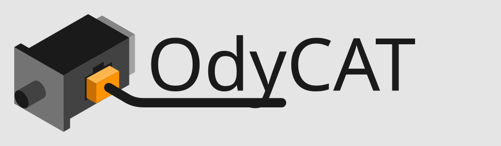

<p align="center">
  <picture>
    <source media="(prefers-color-scheme: dark)" srcset="docs/img/odycat_letters_dark.svg">
    
  </picture>
</p>

<p align="center"><b>Open machine and factory automation with Python</b></p>

<p align="center">
  <a href="https://pypi.org/project/odycat/"></a>
  <a href="https://pypi.org/project/odycat/"></a>
  <a href="https://github.com/odycat/odycat/blob/main/LICENSING.md"></a>
  <a href="https://github.com/odycat/odycat/actions/workflows/ci.yml"></a>
  <a href="https://docs.odycat.org/en/stable/"></a>
  
</p>

<p align="center">English · <a href="README.es.md">Español</a></p>

## What is OdyCAT

OdyCAT lets Python scripts control EtherCAT devices from a Linux computer:
I/O terminals (digital, analog, counters, PWM...), frequency inverters,
servo drives and other EtherCAT slaves.

It is for automation engineers, integrators, production lines, research
teams, robotics hobbyists and maintenance staff: a robust tool that lets them
focus on their application instead of fighting the fieldbus.

Machine control, servo drives, guidance and navigation algorithms and
machine vision can run on the same computer, in one of the world's most
widely used programming languages. Together with libraries such as OpenCV,
NumPy, SciPy, Matplotlib, PyQtGraph, FastAPI, SQLite or Snap7, it makes a
solid stack for building robots and machines.

What it looks like: switch an output on for one second.

```python
import time
from odycat.devices.beckhoff import EL2004

out = EL2004(label="outputs")   # the EL2004 labelled outputs in the config
out.set_output_1(True)          # output 1 on
time.sleep(1)
out.set_output_1(False)         # output 1 off
```

## Quick start

- **Hardware:** a PC or board with x86-64 or aarch64 (ARM, Raspberry Pi) and
  an RJ45 Ethernet port for the bus. 10/100 Mb/s is enough; a PCI or on-board
  port is better than a USB-Ethernet adapter, which also works, with more
  jitter (see [cycle time and jitter](docs/realtime.md)).
- **System:** a clean Debian 13, Ubuntu 24.04 or 26.04 LTS, Raspberry Pi OS
  or Armbian, with the EtherCAT slaves connected to that port.

```sh
sudo apt install git
git clone https://github.com/odycat/odycat
ip a                                    # see which card is the bus
sudo odycat/install/install.sh          # asks which network card is the bus
# log out and in again (or reboot): the installer added you to the odycat group

mkdir odycat_test && cd odycat_test
python3 -m venv .venv                   # keeps OdyCAT out of the system's Python
source .venv/bin/activate
pip install odycat
odycat-config scan -o busconfig.json    # a config from the connected slaves
sudo odycat busconfig.json              # the engine: leave it running

# in another terminal, in odycat_test:
.venv/bin/python -c "from odycat import Bus; b = Bus(); print('OP' if b.is_op else 'not OP', b.work_counter, '/', b.expected_wkc)"
```

Each step is explained in [getting started](docs/getting-started.md).

## Why OdyCAT

- **One PC, one language, full control:** I/O, drives, vision, databases and
  your HMI in Python, on the same computer.
- **One Python script per task:** a real-time C engine runs the cycle and
  exchanges data with your scripts through shared memory. Run as many scripts
  as you need and split a machine, or a whole line, into small independent
  programs, easy to read and maintain.
- **No vendor IDE, no runtime keys, no time limits, nothing between you and
  the machine:** any editor and the usual Python tools, AI assistants
  included. It's Python, after all.
- **No artificial limits** on device count, axes or I/O. Bus cycle times
  from 125 µs to 10 ms; your hardware and its load set the real limits.
- **See what happened:** a cycle-by-cycle trace of recent activity, and
  events on edges, value changes and slaves leaving OP.
- **Batteries included:** ready-to-use device classes, each with a stated
  support tier: tested by the project on the real device before each
  release, maintained by the device's manufacturer, or by the community
  ([device catalogue](docs/devices.md)).
- **Security support:** every release has a published support period and a
  vulnerability policy ([SECURITY.md](SECURITY.md)); with a commercial
  licence, the OdyCAT-specific security information for your machine's
  technical file (EU Cyber Resilience Act).
- **Deploy where you want:** x86-64 and ARM, from fanless industrial PCs to
  single-board computers (Raspberry Pi, Orange Pi, Odroid...). Run your
  scripts on the host or in [containers](docs/containers.md).
- **Open source, developed in the EU, part of the free software
  ecosystem:** inspect, modify, combine with other projects, and keep the code
  your machines run. Make your robotics and automation stack resilient.

## Where OdyCAT fits

- **Machine control applications:** work with I/O and drives from Python on
  Linux, alongside machine vision, SCADA or data-processing software.
- **Integration and commissioning:** configure devices, inspect bus data and
  use events and recent cycle history to investigate machine behaviour.
- **Test benches and prototypes:** work at a higher level than firmware,
  using industrial devices from the outset.

For more detail, see [intended use](docs/intended-use.md) and [supported environments](docs/compatibility.md).

## How it works

OdyCAT drives the [IgH EtherCAT Master](https://gitlab.com/etherlab.org/ethercat)
through a small real-time C engine, which mirrors the process data of every
slave into shared memory. Scripts read inputs and write outputs there with
the `odycat` package, without making the engine wait for Python (scripts
that write the same outputs coordinate with a lock held for microseconds).

The engine runs the bus cycle; how steady it is depends on the computer and
its load. The defaults are enough for most applications. For tighter timing
or faster cycles, see [cycle time and jitter](docs/realtime.md) and
[intended use](docs/intended-use.md).

```
 Python scripts  ⇄  shared memory  ⇄  odycat (C, real time)  ⇄  IgH master  ⇄  slaves
```

Scripts can also act on bus events, and wait for a time or for a number of
bus cycles:

```python
from odycat import Events
from odycat.devices.beckhoff import EL1014, EL2004

inp = EL1014(label="inputs")
out = EL2004(label="outputs")
ev = Events()

@ev.rising(inp.input_1)             # called when input 1 switches on
def pressed(e):
    out.set_output_1(not out.output_1())

while True:
    ev.sleep(0.1)                   # handlers run here, in this thread
```

- **Device classes** for drives (CiA 402) and I/O, by vendor, with every
  variable as a method your editor completes; generic classes for standard
  profiles (CiA 402, CiA 401, ETG.5001 modular I/O).
- **Events** on rising and falling edges, value changes, slaves leaving OP.
- **Trace**: the engine keeps a rolling record of the process data of recent
  cycles (10 s by default). Read it before the ring overwrites older data;
  it is not a persistent audit log.
- **`odycat-config scan`** writes the bus configuration from what the
  connected slaves report about themselves, so many devices work without
  configuration files of their own.

## Documentation

Start with [getting started](docs/getting-started.md) (installing IgH and
OdyCAT, a first config, starting the engine). Everything else is listed in
the [documentation index](docs/README.md).

## Get in touch

Working on a machine or evaluating OdyCAT for an application? We'd be glad to
hear about it; [contact Yoctovision](https://www.yoctovision.com). For bugs,
improvements and contributions to the library, see
[CONTRIBUTING.md](CONTRIBUTING.md). Report security problems privately, as
soon as you can, through [SECURITY.md](SECURITY.md).

## Licence

OdyCAT is available under the GNU GPL v3 or a commercial licence, see
[LICENSING.md](LICENSING.md). Contributions are welcome under
[CONTRIBUTING.md](CONTRIBUTING.md); decisions are described in
[GOVERNANCE.md](GOVERNANCE.md). Security problems go to
[SECURITY.md](SECURITY.md), not to public issues.

## Motivation

I'm Javier Martínez, the author of OdyCAT and technical director of
Yoctovision, the company that supports it. I have worked for more than ten
years on control systems, real time, automation and machine vision, from
electronics to industrial applications. Open source taught me most of it
and gave me most of the tools I have built my work on. OdyCAT is my way of
giving something back: the tool I wanted to have, the one I use in my own
projects, now open to everyone who finds it useful. I look forward to seeing
what you build with it, and to teaching and helping along the way.
Yoctovision's commercial licences and engineering services help to sustain
and grow the project.

<p align="center">Developed in Spain, EU 🇪🇺</p>

<sub>OdyCAT® is copyright © Ocean Octane S.L.U. and is published and
supported by Yoctovision S.L.U. under licence. OdyCAT® name and logo are registered
trademarks of Ocean Octane S.L.U. EtherCAT® is a registered trademark and
patented technology, licensed by Beckhoff Automation GmbH, Germany. All other
company and product names are the trademarks of their respective owners and
only identify the hardware OdyCAT works with.</sub>
