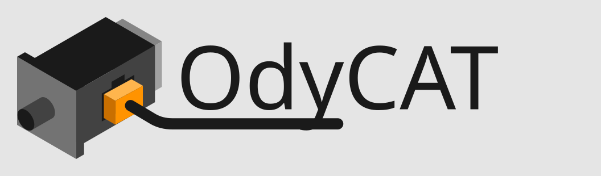

<p align="center">
  <picture>
    <source media="(prefers-color-scheme: dark)" srcset="img/odycat_letters_dark.svg">
    
  </picture>
</p>

<p align="center"><b>Developed by Javier Martínez García at Ocean Octane · published and supported by Yoctovision</b></p>

<!-- site: the documentation website includes this page from here on -->

# OdyCAT documentation

OdyCAT is an EtherCAT framework for Linux. A real-time C engine
(`odycat`) runs the IgH EtherCAT master and mirrors the process data
of every slave into POSIX shared memory. Python scripts attach to that shared
memory with the `odycat` package and read inputs / write outputs without
waiting for the engine. Output writers use short locks to coordinate with
one another.

```
 ┌──────────────┐  shm /<iface>_shared   ┌──────────────────┐   IgH    ┌────────┐
 │ Python app   │ <────────────────────> │  odycat   │ <──────> │ slaves │
 │ (odycat pkg) │  shm /<iface>_config   │  (C, SCHED_FIFO) │  kernel  └────────┘
 └──────────────┘ <───────────────────── └──────────────────┘
```

## Contents

| Document | Read it when |
|---|---|
| [getting-started.md](getting-started.md) | Installing, building, starting the engine, first script |
| [architecture.md](architecture.md) | You want to know how the engine, shared memory and seqlock work |
| [configuration.md](configuration.md) | Writing or changing a `config.json` (full field reference) |
| [python-api.md](python-api.md) | Using `Bus`, `Device`, `BusMonitor` and the config helpers |
| [devices.md](devices.md) | Using the bundled device classes, or writing a new one |
| [tools.md](tools.md) | `odycat-config` (scan, expand, prepare), building the engine and the wheel |
| [realtime.md](realtime.md) | Cycles are late or skipped, DC drives drop out, or you want a shorter cycle |
| [containers.md](containers.md) | Scripts in Docker or other containers, with the engine on the machine |
| [troubleshooting.md](troubleshooting.md) | The engine refuses to start, or values look wrong |
| [compatibility.md](compatibility.md) | What a version number promises, what may change, how things are deprecated |
| [testing.md](testing.md) | What the unit tests cover, how to run them, what CI does |
| [api.md](api.md) | Every class and function, from the docstrings (best read on the documentation site, `make docs`, which also generates the device catalogue) |
| [llm-reference.md](llm-reference.md) | Self-contained summary for AI coding assistants (copy it into other projects) |

## Repository layout

```
Makefile               Development tasks: make engine | wheel | install | test | lint
engine/                C real-time engine and its Makefile (sources: architecture.md)
setup.py, pyproject.toml
                       Wheel build: the Python package (and its C helper; the engine is installed apart)
LICENSE, LICENSING.md  GPL v3 text; dual licensing (GPL v3 or commercial)
src/odycat/            Python package
  _config.py           Config SHM reading, slave lookup, PDO layout rules
  bus.py               Bus: shm header (state, WKC, cycle counter)
  device.py            Device: base class for all slave classes
  monitor.py           BusMonitor: read-only whole-bus snapshots
  trace.py             Trace: the engine's cycle history (trace shm)
  events.py            Events: handlers called on PDO changes
  _scan.py             `odycat-config scan`: a config from the slaves on the bus
  _prepare.py          `odycat-config prepare`: the one-off change some devices need
  _esi.py              EtherCATInfo XML from `ethercat xml` (internal, for scan)
  testing.py           Fake engine for tests without hardware (may change in any release)
  _profiles.py         Device profiles ("device": "leadshine.ECT60" in the config)
  devices/             Device catalogue: vendors, "vendor.Model" names
  devices/<vendor>/    Device classes by vendor (see devices.md)
  devices/cia402/      Standard CiA 402 drive profile (Servo)
  devices/mdp/         ETG.5001 Modular Device Profile digital I/O (DigitalIO)
  devices/cia401/      CiA 401 generic I/O (GenericIO)
install/               The installer: IgH, the bus card and the engine
examples/              Example scripts and configs (demo.py + config.json, demo_box.json, events, recovery)
packaging/             System files: udev rule, systemd unit, sysusers.d, polkit rule
tests/                 Unit tests, no hardware needed (see testing.md); bus output recorded from the demo box in tests/data/
docs/                  This documentation; the website is built from it (make docs)
ci/                    The scripts the CI runs (lint, tests, builds); they work the same locally
```

## Conventions used in these docs

- **Direction names follow EtherCAT (ETG).** PDOs are named from the
  slave's side, as in ESI files, TwinCAT and `ethercat pdos`: `rxpdo` is what
  the slave *receives* (its **outputs**: control, targets; RxPDOs `0x16xx`,
  SM2) and `txpdo` is what it *transmits* (its **inputs**: status, actual
  values; TxPDOs `0x1Axx`, SM3; slaves without a mailbox use SM0/SM1,
  given by `"sm"`).
- Slave addresses are written `alias:position`, as `ethercat slaves` prints
  them.

---

OdyCAT® is developed by Javier Martínez García at Ocean Octane and published
and supported by Yoctovision S.L.U. under licence. Copyright © 2026 Ocean
Octane S.L.U.; OdyCAT® is its registered trademark. GPL v3 or commercial
licence, see [LICENSING.md](../LICENSING.md).
